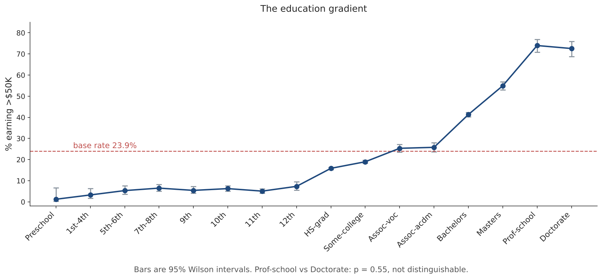
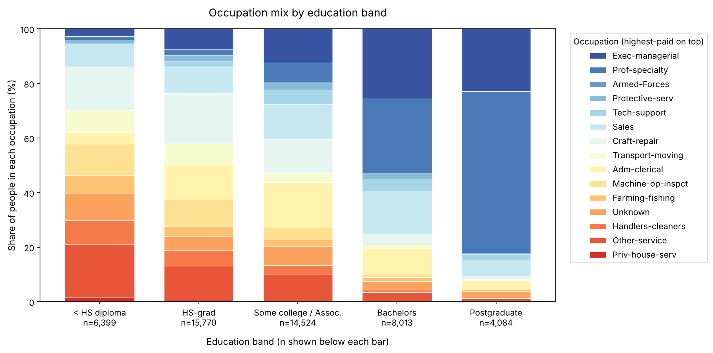
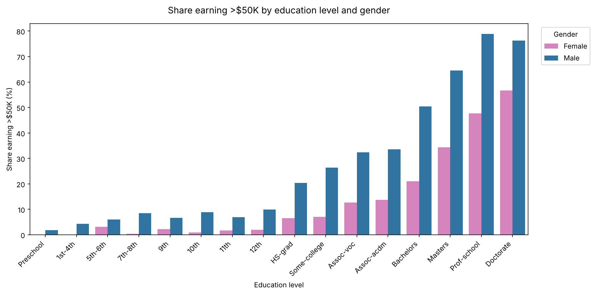

# Is Education the Way?

**LUMS Science Symposium Data Science category · ISL PA Team A**
Umer, Saad, Inayah, Hania & Minahil

Does more education mean a higher chance of earning over $50K, does something else do more of the work, and for whom does education pay more or less? We answer this with the 1994 US Census "Adult" dataset (48,842 employed adults).

📊 **Slides:** [`lss_presentation.pdf`](lss_presentation.pdf)



## Key findings

| | Finding |
|---|---|
| **Education ranks high** | Education explains **13.4%** of the variation in who earns >$50K (η²), more than occupation (12.3%), age (9.7%), hours (7.4%), gender (4.6%) or race (1.0%). Only marital status is higher (20.1%), and that figure is distorted because most married women are missing from the file. |
| **The gradient is flat, then steep** | 1.2% (Preschool) to 7.3% (12th grade), then more than doubles to 15.9% at HS-grad, the first level with a diploma. Prof-school (74.0%) and Doctorate (72.6%) cannot be told apart (p = 0.55). |
| **Part of it is the job you get** | Among people with a recorded occupation, the share working in the two best-paid occupations rises from 4.5% (< HS diploma) to 84.3% (postgraduate), while the >$50K rate rises from 6.1% to 61.8%. |
| **Missing data is not random** | The 2,805 people with no recorded occupation earn >$50K at 9.45% vs 24.83% for everyone else (z = −18.53). We keep them instead of silently dropping them. |

The slides also cover a regression model, an occupation decomposition, odds ratios by gender and Mantel–Haenszel stratification. Those results are in the presentation; `lss_code.py` reproduces the tables and figures listed below.

**Limitations:** the file contains only people with earnings, so education's effect on getting a job at all is invisible and every effect here is a lower bound. The data is from 1994 and describes that labour market, not today's.

## What the script produces

| Output | Description |
|---|---|
| Table 1 | People with vs without a recorded occupation, plus a two-proportion z-test |
| Table 2 | All nine variables ranked by η² and by rate range |
| Table 3 | >$50K rate at each of the 16 education levels, with 95% Wilson intervals |
| Table 4 | Share in Exec-managerial / Prof-specialty vs >$50K rate, by education band (rows with a recorded occupation) |
| Figures 1–4 | Saved to [`figures/`](figures) |

<table>
<tr>
<td></td>
<td></td>
</tr>
</table>

## Running it

```bash
pip install -r requirements.txt
```

Put the dataset at `data/data.csv` (see below), then:

```bash
python lss_code.py
```

Options: `--data PATH` to read a CSV from somewhere else, `--out DIR` to change where figures are saved, `--show` to open the figures in a window.

In Google Colab, upload the CSV or mount Drive and run `!python lss_code.py --data /content/drive/MyDrive/data.csv`.

### Getting the data

The dataset is the [UCI Adult / Census Income dataset](https://archive.ics.uci.edu/dataset/2/adult) (CC BY 4.0), with `adult.data` and `adult.test` combined into one file of 48,842 rows. The script expects this header:

```
age,workclass,fnlwgt,education,educational-num,marital-status,occupation,relationship,race,gender,capital-gain,capital-loss,hours-per-week,native-country,income
```

To build it from the UCI files:

```python
import pandas as pd
cols = ['age', 'workclass', 'fnlwgt', 'education', 'educational-num', 'marital-status', 'occupation',
        'relationship', 'race', 'gender', 'capital-gain', 'capital-loss', 'hours-per-week',
        'native-country', 'income']
train = pd.read_csv('adult.data', header=None, names=cols, skipinitialspace=True)
test = pd.read_csv('adult.test', header=None, names=cols, skipinitialspace=True, skiprows=1)
data = pd.concat([train, test])
data['income'] = data['income'].str.rstrip('.')
data.to_csv('data/data.csv', index=False)
```

## Method in brief

1. **Diagnose:** `?` used as a null marker, 52 duplicate rows, `capital-gain` leaking the label (all 244 rows at the 99999 cap earn >$50K), non-random missing occupations.
2. **Clean:** drop `fnlwgt` (a sampling weight), `capital-gain`/`capital-loss` (leakage) and `relationship`; flag missing occupation as `Unknown`; bin education, age and hours.
3. **Stratify:** group rate → Wilson interval → two-proportion z-test. A binary column's mean is its proportion, and Wilson intervals stay inside 0–100% for small groups.
4. **Rank:** η² weights every category by its size, so a tiny group cannot dominate the ranking the way it can with a simple max–min range.

## License

[MIT](LICENSE)
